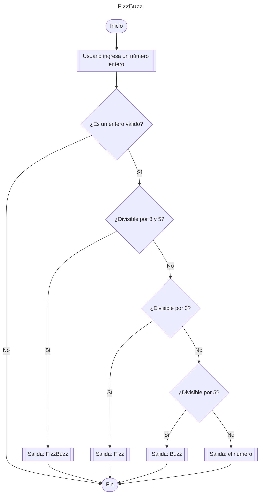

# FizzBuzz

## Descripción
Este proyecto implementa el clásico problema de FizzBuzz.

## Diagrama de Flujo

## Lógica del Programa

1. Se verifica si el número es divisible por 3 y 5 (divisible por 15) → imprime "FizzBuzz"
2. Si no, verifica si es divisible por 3 → imprime "Fizz"
3. Si no, verifica si es divisible por 5 → imprime "Buzz"
4. Si ninguna condición se cumple → imprime el número